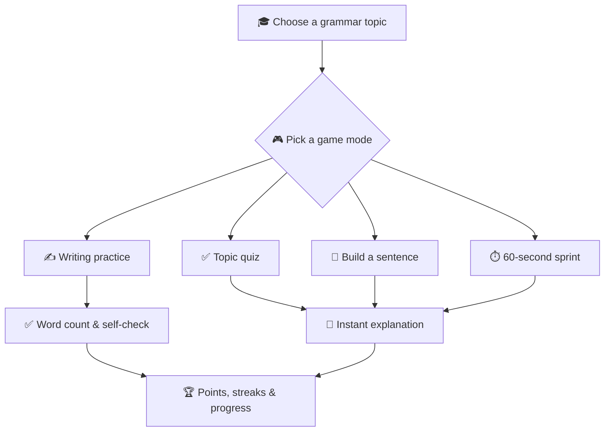
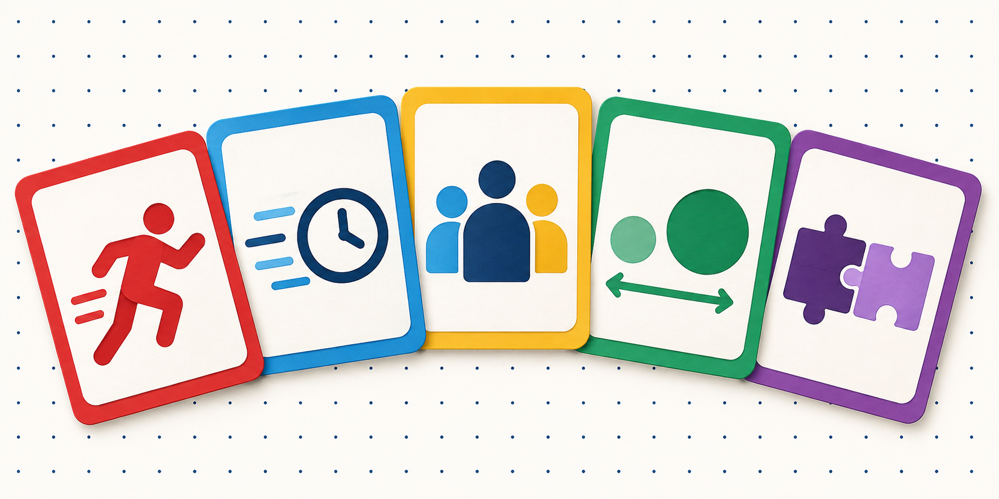

<div align="center">


# 🇩🇰 Ordværk

### 🎯 Interactive Danish grammar training for A2-B1 learners

## 🧠 ✦ 🎮 ✦ 🧩 ✦ ⚡ ✦ 🏆

**Practice. Play. Understand. Repeat.** ✨

### 👉 [**Start practising now — open Ordværk**](https://alketcecaj12.github.io/dansk_grammatik_traening_app/) 👈

*Free, no sign-up, works on phone, tablet and desktop.*

[](https://developer.mozilla.org/en-US/docs/Web/HTML)
[](https://developer.mozilla.org/en-US/docs/Web/CSS)
[](https://developer.mozilla.org/en-US/docs/Web/JavaScript)
[](#-technology)
[](https://alketcecaj12.github.io/dansk_grammatik_traening_app/)

</div>

---

## 👋 What is Ordværk?

**Ordværk** is a responsive web app that makes Danish grammar and writing practice feel more interactive. It is designed for learners around levels **A2-B1** and works entirely in the browser - no account, database, or installation required.

Learners receive instant feedback, short explanations, points, streaks, and progress tracking while practising five essential grammar areas.

> 💡 **The idea:** small exercises, clear explanations, and frequent repetition make grammar easier to remember.

## 🧭 How it works



## 🎮 Training modes

| Mode | What the learner does | Best for |
| --- | --- | --- |
| 🎲 **Mixed quiz** | Answers 10 questions from every topic | General revision |
| 🎯 **Topic practice** | Focuses on one grammar category | Targeted improvement |
| 🧩 **Build the sentence** | Places Danish words in the correct order | Word order |
| ⏱️ **60-second sprint** | Answers as many questions as possible | Speed and recall |
| ✍️ **Writing practice** | Writes e-mails, notices, applications, and complaints | Danskprøve preparation |

## 📚 Grammar topics

| Icon | Topic | Learners practise |
| :---: | --- | --- |
| 🔴 | **Verber** | Present, past, perfect tense, auxiliaries, and modal verbs |
| 🔵 | **Adverbier** | Placement, direction, and central adverbs |
| 🟡 | **Pronominer** | Personal, reflexive, possessive, and indefinite pronouns |
| 🟢 | **Adjektiver** | Agreement, comparison, and irregular forms |
| 🟣 | **Konjunktioner** | Subordinate clauses, connectors, and Danish word order |

<div align="center">



_🔴 Verber · 🔵 Adverbier · 🟡 Pronominer · 🟢 Adjektiver · 🟣 Konjunktioner_

</div>

## ✨ Features

- 📝 **50 self-correcting questions** across five grammar topics
- 🧩 **10 sentence-building challenges**
- ✍️ **10 realistic writing tasks** with timers and minimum word counts
- 💾 Automatically saved writing drafts
- ✅ Writing requirements, self-check lists, useful phrases, and model answers
- ⚡ Immediate feedback after every answer
- 💬 Short, learner-friendly grammar explanations
- 🏆 Points and answer streaks
- 📅 A daily practice goal
- 📈 Best scores saved separately for each topic
- 💾 Progress stored locally in the browser
- ⌨️ Keyboard-friendly controls and visible focus states
- 📱 Responsive layout for mobile, tablet, and desktop
- 🚫 No backend, login, database, or build process

## 🛠️ Technology

Ordværk keeps the technical setup intentionally simple:

- 🧱 **HTML5** for structure
- 🎨 **CSS3** for the responsive visual design
- ⚙️ **Vanilla JavaScript** for questions and game logic
- 💾 Browser **`localStorage`** for learner progress

There are **no npm dependencies** and no compilation step. 🎉

## 📁 Project structure

```text
dansk-grammatiktraener/
├── assets/
│   ├── ordvaerk-banner.png  # 🖼️ README hero graphic
│   └── grammar-topics.png   # 🎴 Grammar topic graphic
├── dist/
│   ├── index.html      # 🧱 Page structure and metadata
│   ├── styles.css      # 🎨 Design and responsive layout
│   └── app.js          # ⚙️ Questions, games, and progress
├── .openai/
│   └── hosting.json    # ☁️ OpenAI Sites configuration
└── README.md           # 📖 Project documentation
```

## 🚀 Run locally

### Option 1: open the file

Open **`dist/index.html`** directly in your browser. That is all you need. ✨

### Option 2: use a local server

From the project directory, run:

```bash
python3 -m http.server 8000 --directory dist
```

Then visit **[http://localhost:8000](http://localhost:8000)**.

## 🐙 Push the project to GitHub

Create an empty repository on GitHub, open a terminal in the project directory, and run:

```bash
git init
git add .
git commit -m "Initial version of Ordværk"
git branch -M main
git remote add origin https://github.com/YOUR-USERNAME/YOUR-REPOSITORY.git
git push -u origin main
```

Replace **`YOUR-USERNAME`** and **`YOUR-REPOSITORY`** with your GitHub details.

> ℹ️ **Already using Git?** Skip `git init`. If an `origin` remote already exists, use `git remote set-url origin YOUR-GITHUB-URL`.

## 🌍 Deploy with GitHub Pages

> ✅ **This repository is already deployed.** The live app is at **<https://alketcecaj12.github.io/dansk_grammatik_traening_app/>**, and every push to `main` redeploys it automatically via [`.github/workflows/deploy.yml`](.github/workflows/deploy.yml). The steps below are for setting up your own copy.

Because the website files are inside **`dist/`**, the cleanest GitHub Pages setup uses GitHub Actions.

1. ⚙️ Open your repository on GitHub.
2. 📄 Go to **Settings > Pages**.
3. 🚀 Select **GitHub Actions** under **Build and deployment**.
4. 📁 Create **`.github/workflows/deploy.yml`**.
5. 📋 Add the workflow below.

<details>
<summary><strong>👀 Show the GitHub Pages workflow</strong></summary>

```yaml
name: Deploy to GitHub Pages

on:
  push:
    branches: [main]
  workflow_dispatch:

permissions:
  contents: read
  pages: write
  id-token: write

concurrency:
  group: pages
  cancel-in-progress: true

jobs:
  deploy:
    environment:
      name: github-pages
      url: ${{ steps.deployment.outputs.page_url }}
    runs-on: ubuntu-latest
    steps:
      - name: Check out repository
        uses: actions/checkout@v4

      - name: Configure Pages
        uses: actions/configure-pages@v5

      - name: Upload website
        uses: actions/upload-pages-artifact@v3
        with:
          path: dist

      - name: Deploy website
        id: deployment
        uses: actions/deploy-pages@v4
```

</details>

Commit and push the workflow. GitHub will automatically publish the app after the action finishes. ✅

## ☁️ Other deployment options

The **`dist`** folder is a complete static website, so it can also be deployed to:

- 🟦 Netlify
- 🟧 Cloudflare Pages
- ▲ Vercel
- 🖥️ Any conventional web server

Use these settings:

| Setting | Value |
| --- | --- |
| Build command | _Leave empty_ |
| Publish directory | `dist` |

## ✍️ Add or edit questions

All question data is stored near the top of **`dist/app.js`**.

<details>
<summary><strong>📝 Multiple-choice question example</strong></summary>

```javascript
{
  topic: "verbs",
  q: "I går ___ jeg bussen klokken syv.",
  options: ["tager", "tog", "har taget", "tage"],
  answer: "tog",
  explain: "‘I går’ peger på afsluttet datid. Datid af ‘at tage’ er ‘tog’."
}
```

</details>

The **`answer`** value must exactly match one item in **`options`**.

### 🔑 Supported topic keys

- `verbs` 🔴
- `adverbs` 🔵
- `pronouns` 🟡
- `adjectives` 🟢
- `conjunctions` 🟣

Sentence-building exercises are stored in the **`BUILD_QUESTIONS`** array. The selected words must produce exactly the text stored in **`answer`**.

## ♻️ Reset saved progress

Learner progress is stored under the browser key **`ordvaerk-progress`**. Reset it from the browser developer console:

```javascript
localStorage.removeItem("ordvaerk-progress");
location.reload();
```

## ♿ Accessibility and browser support

Ordværk includes:

- ⌨️ Keyboard navigation
- 🔎 Visible focus states
- 🔊 Screen-reader feedback
- 🧘 Reduced-motion support
- 📐 Responsive layouts

The app is intended for current versions of **Chrome, Firefox, Safari, and Edge**.

## 🧑‍🏫 Content notes

The exercises are original learning activities informed by common Danish grammar patterns. Review all educational content before using the app in a formal course or publishing substantial modifications.

## 🗺️ Ideas for future development

- 🔉 Danish pronunciation audio
- 🏅 Achievements and badges
- 🎚️ More difficulty levels
- 🧠 A review mode for incorrect answers
- 🌐 Interface translations
- 📊 A detailed progress dashboard

## 📜 License

No open-source license is included yet. Add a license file before inviting others to copy, modify, or redistribute the project.

---

<div align="center">

## 💙 ❤️ 💛 💚 💜

### ❤️ Built for people learning Danish 🇩🇰

### 🧠 God fornøjelse med grammatikken! 🎉

</div>
