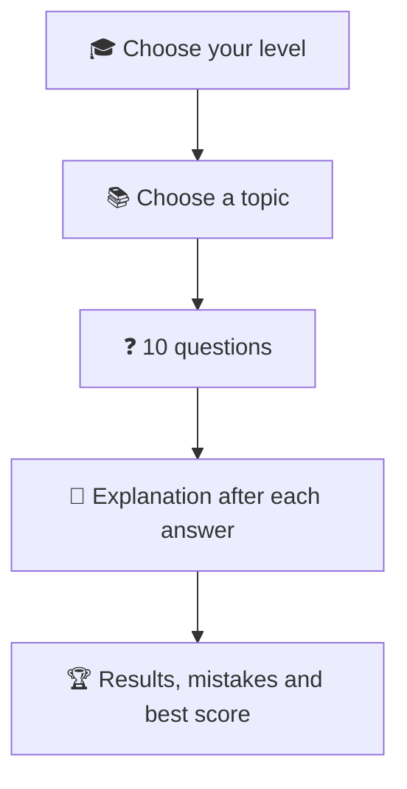

<div align="center">

# 🇩🇰 Danish Grammar Trainer

### Train your grammar for a better score in the PD3 language test (Prøve i Dansk 3)

### 👉 [**Open the app**](https://alketcecaj12.github.io/dansk_grammatik_traening_app/) 👈

*Free, no sign-up, works on phone, tablet and desktop.*

[](https://developer.mozilla.org/en-US/docs/Web/HTML)
[](https://developer.mozilla.org/en-US/docs/Web/CSS)
[](https://developer.mozilla.org/en-US/docs/Web/JavaScript)
[](#-technology)
[](https://alketcecaj12.github.io/dansk_grammatik_traening_app/)

</div>

---

## 👋 What is it?

Danish Grammar Trainer is a browser app for people learning Danish. You choose your level, choose a topic, and answer a round of 10 questions. Every answer gets an instant explanation in English, and a results screen goes through your mistakes at the end.

The interface is in English and only the exercises are in Danish. An Italian interface is planned.

## 🧭 How it works



## 🎓 Levels

| Level | CEFR | Focus |
| --- | :---: | --- |
| **Beginner** | A1 | Pronouns, present tense, simple word order, telling the time |
| **Beginner–intermediate** | A2 | Past tenses, conjunctions, inversion, comparing things |
| **Intermediate–advanced** | B1 | Førdatid, indirect speech, sin/hans, relative clauses, talking about time |

## 📚 Topics (in every level)

| Topic | What you practise |
| --- | --- |
| 🔴 **Verbs** | Tenses, modal verbs and irregular forms |
| 🔵 **Adverbs** | ikke, også, altid … and ud/ude, hjem/hjemme |
| 🟢 **Adjectives** | Endings, comparison and irregular forms |
| 🟡 **Pronouns** | Personal, possessive and reflexive pronouns |
| 🟠 **Prepositions** | i, på, til, fra, med, om, af … |
| 🟣 **Conjunctions** | og, men, fordi, da, når, hvis, om … |
| 🔀 **Inversion & word order** | Where the verb and the adverb go |
| 📖 **Learn new words** | 800 / 1,000 / 1,500 words (Beginner / Beginner–intermediate / Intermediate–advanced): see a Danish word, pick its English meaning out of four, then read it in a Danish sentence with its English translation underneath |
| 🕒 **Can you tell the clock?** | Beginner and Beginner–intermediate: read a clock face and say the time in Danish (*halv tre* = 2:30) |
| 📅 **Can you talk about time?** | Intermediate–advanced: i dag, i går, i forgårs, i morgen, i overmorgen, for … siden, om … |
| ✍️ **Let's train your writing** | Translate an English sentence into Danish and get a score |

## 🎮 Question types

- ✅ **Multiple choice:** pick the right word out of four options (keys 1–4 work too)
- ⌨️ **Type the form:** write the missing word, with æ ø å buttons
- 🧩 **Build the sentence:** tap word tiles in the right order
- 🕒 **Clock:** a drawn clock face with new times every round; the wrong options are the typical mistakes
- ✍️ **Writing:** type the Danish sentence and press Enter
- 📖 **New words:** a Danish word and four English meanings; the wrong ones are words of the same kind (noun, verb …) from the same level. After you answer, the word is shown in an example sentence

### How writing is scored

Your sentence is compared word by word with a hidden Danish answer:

- right word in the right place = 1 point
- small spelling slip (one letter, or *ae/oe/aa* for *æ/ø/å*) or right word in the wrong place = ½ point
- score = points ÷ number of words in the longer sentence

So all words right gives 100%, and one missing word in a three-word sentence gives 67%. The correct sentence is then shown with every word marked as right, slightly off, or missing.

## ✨ What's inside

- 📝 **302 grammar questions** across 3 levels and 7 topics
- 📅 **27 questions** about talking about time
- 📖 **3,300 new words** (800 / 1,000 / 1,500 per level, no word repeated across levels), each with a Danish example sentence and its English translation
- 🕒 **Clock questions generated fresh** every round
- ✍️ **242 writing phrases** (82 Beginner, 80 Beginner–intermediate, 80 Intermediate–advanced)
- 💬 A short English explanation of why the answer is right, after every question
- 🏆 Points, best streak and best score per topic, saved in the browser
- 🌗 Light and dark mode, responsive layout, keyboard friendly

## 🛠️ Technology

Plain **HTML, CSS and JavaScript**. No framework, no npm, no build step, no server. Progress is stored in the browser's `localStorage`.

## 📁 Project structure

```text
dansk_grammatik_traening_app/
├── dist/                     # the website (this is what GitHub Pages publishes)
│   ├── index.html
│   ├── css/styles.css        # cobalt look, light/dark mode, phone layout
│   └── js/
│       ├── i18n-en.js        # every interface text (English)
│       ├── quiz-data.js      # grammar questions per level and topic
│       ├── clock.js          # clock questions, generated each round
│       ├── writing-data.js   # writing phrases per level
│       ├── writing-score.js  # writing score
│       ├── vocab-*.js        # Learn new words: 800 / 1,000 / 1,500 words, type|Danish|English|sentence|translation
│       └── app.js            # screens and quiz logic
├── .github/workflows/deploy.yml  # publishes dist/ to GitHub Pages on every push to main
└── README.md
```

## 🚀 Run locally

Open **`dist/index.html`** in your browser. That's all.

Or serve it:

```bash
python3 -m http.server 8000 --directory dist
```

and visit <http://localhost:8000>.

## 🌍 Deployment

Every push to `main` publishes `dist/` to GitHub Pages through [`.github/workflows/deploy.yml`](.github/workflows/deploy.yml). In **Settings › Pages**, the source must be set to **GitHub Actions**.

## ✏️ Editing content

- **Questions:** `dist/js/quiz-data.js`. Each level has a list per topic. Helpers: `c(question, answer, options, explanation)` for multiple choice (write the gap as `___`), `t(question, answer, explanation)` for typing, `o(answer, explanation)` for word tiles.
- **Writing phrases:** `dist/js/writing-data.js`, as `{ en, da, alt }`. Put optional words in brackets, like `(at)`, and other correct answers in `alt`.
- **Interface text:** `dist/js/i18n-en.js`. For the Italian version, copy it to `i18n-it.js`, translate the values and change the script tag in `index.html`.

## ♻️ Reset progress

Use **Reset my progress** at the bottom of the page, or run this in the browser console:

```javascript
localStorage.removeItem("dgt-progress");
location.reload();
```

## 🧑‍🏫 Content notes

All sentences are original, written in the style of common Danish course books (Sådan 1 and 2, "Test din viden"). Please review the content before using it in a formal course.

## 📜 License

No license yet. Add one before inviting others to copy or reuse the project.

---

<div align="center">

### God fornøjelse med grammatikken! 🇩🇰

</div>
